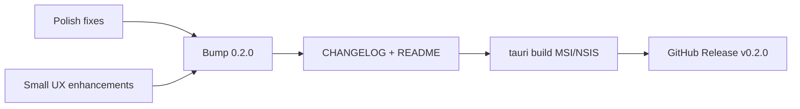

# x-xp v0.2.0 — polish and GitHub release

## Goal
Turn the current `0.1.0` tree (feature-rich after Phases 2–8 + Locksmith/Peek/tags) into a **creditable 0.2.0 GitHub release**: docs match the app, version numbers align, installer builds cleanly, and a few UX polish items make first-run feel intentional.

**Locked scope:** polish + small enhancements (not a new major feature phase). Out of scope for 0.2.0: Git integration, Fluent redesign, content search, archive formats beyond zip, embedding Peek/term UI.

## What’s already in (to document as 0.2.0)
From recent `main` commits through `421cfd0`, plus pending [`tools.rs`](../../src-tauri/src/commands/tools.rs) involvex-term probe fix:

- Live folders, transfer progress/cancel, search panel
- Rich preview + resize; dual-pane + sidebar resize/collapse
- Undo/redo (delete/rename/copy/move)
- Sidebar/home context menus, snap-to-split, font/zoom
- Tags edit/remove + Settings CRUD; colored file-type icons
- FileLocksmith, PowerToys Peek (Ctrl+Space), Open in Terminal

Versions today are still **`0.1.0`** in `package.json`, `src-tauri/Cargo.toml`, `src-tauri/tauri.conf.json`. README is behind. No `CHANGELOG.md`, no `.github` release workflow.

## A. Release polish (must ship)
1. **Commit** pending terminal probe update in `src-tauri/src/commands/tools.rs` (`D:\repos\…`, `nt -d`).
2. **Version bump** to `0.2.0` in package.json, Cargo.toml, tauri.conf.json (keep them in sync).
3. **Add `CHANGELOG.md`** — Keep a Changelog style; `## [0.2.0]` summarizing user-facing items; note Windows-first / PowerToys optional.
4. **Refresh `README.md`** — Features list, shortcuts (Ctrl+B, Ctrl+Space Peek, Ctrl+/- zoom, Ctrl+Z/Y), optional PowerToys + involvex-term, build/install, rollback unchanged.
5. **About / version surface** — Settings General: show `0.2.0` from a single constant so support/screenshots are clear.
6. **Smoke checklist** (manual before tag): CLI open path; dual-pane + collapse; Peek if PowerToys present; Locksmith; Open in Terminal; undo delete; search cancel.
7. **Build** — `bun run tauri:build`; attach MSI + NSIS to the release.
8. **GitHub Release** — tag `v0.2.0`, paste CHANGELOG section (publish only when asked). Optional later: release CI.

## B. Enhancement pack (v0.2.0 UX wins)
| Item | Why |
|------|-----|
| Empty / error states | Clear empty folder, search-no-results, missing Locksmith/Peek/term → Settings hint |
| Settings → Tools defaults hint | Placeholder / hint for blank tool paths |
| First-run toast | Once after upgrade: “v0.2.0 — Ctrl+Space Peek, tags in Settings” |
| Context menu / cheatsheet pass | en/de + shortcut list matches behavior |
| Icon pass | Confirm tray/window icons in bundle |

## C. Release procedure
1. Land polish + enhancements on `main`.
2. `bun run check && bun run lint && bun run format` + `cargo check`.
3. Bump versions → CHANGELOG → README → commit `chore: release v0.2.0`.
4. `bun run tauri:build`.
5. Tag + `gh release create` when you ask to publish.

## Success criteria
- App and installer report **0.2.0**.
- README/CHANGELOG describe Locksmith, Peek, tags, undo, dual/sidebar, zoom.
- Terminal open finds involvex-term without a Settings path on your machine.
- GitHub Release has notes + Windows installers.

## Explicit non-goals for 0.2.0
Automated release CI, macOS/Linux packaging, theme marketplace, Git column, 7z/rar, replacing in-app preview with Peek only.

## Todos
- [ ] Commit involvex-term D:\ probe + nt -d launch
- [ ] Empty/error states, About version, first-run toast, i18n/cheatsheet pass
- [ ] Bump 0.2.0; CHANGELOG + README refresh
- [ ] check/lint/format + cargo check + tauri build smoke
- [ ] Tag v0.2.0 and GitHub Release with MSI/NSIS (when asked to publish)
